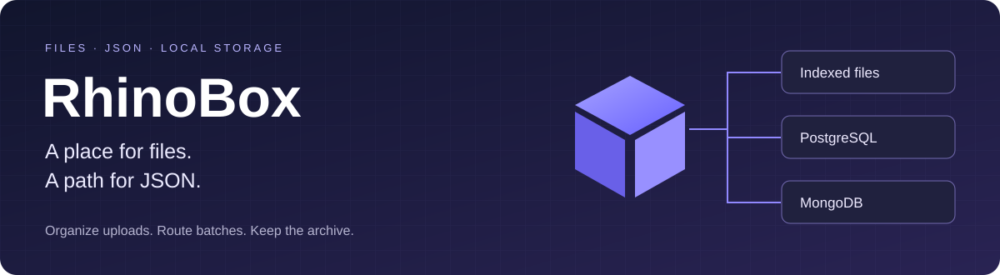
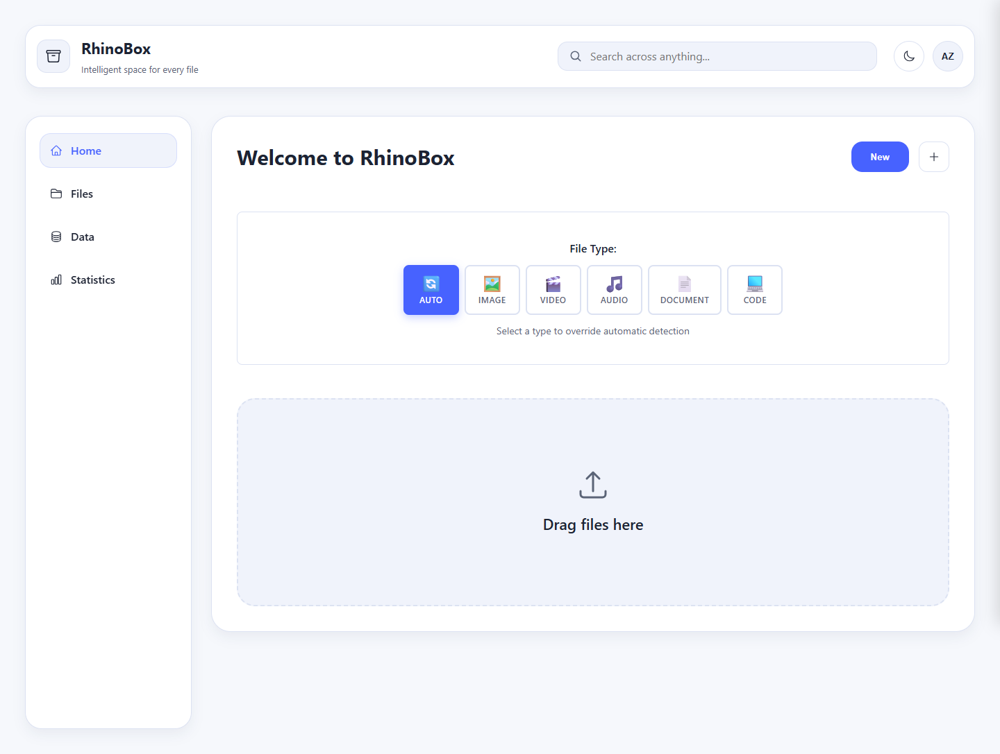
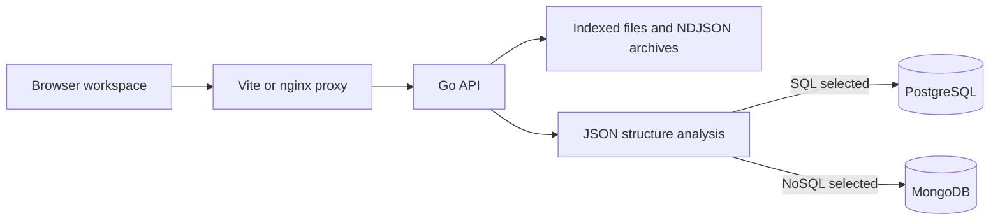
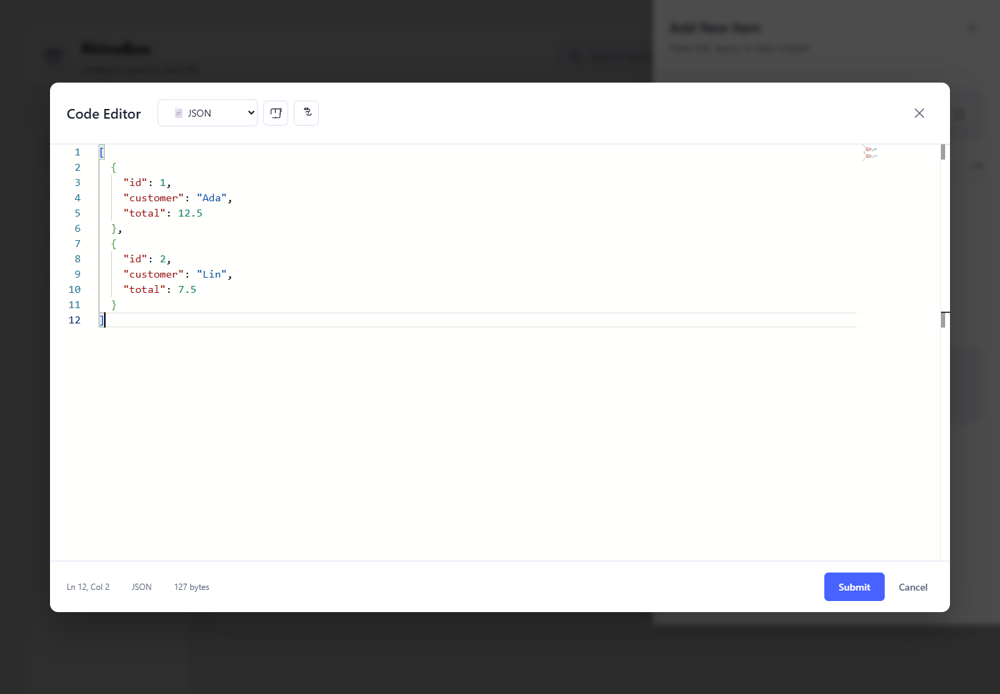

<div align="center">



**A local workspace for organizing files and routing JSON into the right kind of store.**

Upload files, find them again, and send JSON batches to PostgreSQL or MongoDB from the same interface.

[](https://github.com/Muneer320/RhinoBox/actions/workflows/ci.yml) [](LICENSE) [](backend/go.mod)

[**Try locally**](#try-it-locally) · [**See the workflow**](#from-upload-to-stored-data) · [**Developer guides**](#developer-guides)

</div>

## One workspace for two storage problems

Files need names, collections and a way to find them. JSON batches also need a storage decision: a flat, consistent shape fits a relational table differently from a deeply nested document. RhinoBox brings those workflows together: browse indexed files, inspect a structural routing decision, and keep a downloadable archive of each JSON batch.



*Real local application capture. The demo uses synthetic files and records; no personal uploads are shown.*

| Find your files | Send JSON somewhere useful | Keep the result visible |
| --- | --- | --- |
| Collections, metadata/content search, previews, downloads and notes | Structural heuristics recommend SQL or NoSQL; configured adapters write to PostgreSQL or MongoDB | Responses distinguish database inserts from archived records; NDJSON batches remain downloadable |

> [!NOTE]
> **Team-built hackathon prototype; maintained as a local, single-user demo.** No external account or API key is needed. Authentication and tenant isolation are not implemented; keep it on your own machine.

## From upload to stored data



File classification uses MIME types/extensions and saved rules. JSON routing examines structure; it does not infer the meaning of a document. The selected backend and actual insert/archive counts are returned separately.

<details>
<summary><strong>See JSON entry in the running application</strong></summary>



The editor submits JSON to the API. **Data** lists retained SQL/NoSQL-routed archives; **Files → JSON Documents** provides their downloads and normal file controls. Data is an archive inventory, not a live database console.

</details>

## Try it locally

Install Git and Docker with Compose v2. From a terminal:

```sh
git clone https://github.com/Muneer320/RhinoBox.git
cd RhinoBox
docker compose -p rhinobox-demo up --build --wait --wait-timeout 180
```

**Open [localhost:5173](http://127.0.0.1:5173).** The Go API health check is [localhost:8090/healthz](http://127.0.0.1:8090/healthz). PostgreSQL and MongoDB start with the application and use internal container networking. Web ports bind only to loopback; the included database password is a local demo default.

1. Upload a small image or text file from **Home**. Auto uses its MIME type/extension; the type selector can override it.
2. Open **Files**, select a collection, and try download, rename and notes. Reload to see saved changes.
3. Choose **Add New Item**, paste this batch and submit:

   ```json
   [{"id":1,"customer":"Ada","total":12.5},{"id":2,"customer":"Lin","total":7.5}]
   ```

4. The response reports the actual storage backend. Find its archive in **Data** or **Files → JSON Documents**. The [walkthrough](docs/DEMO.md) includes a nested example for MongoDB and database verification.

Stop while keeping files, metadata and database records:

```sh
docker compose -p rhinobox-demo stop
```

Use the same Compose project name next time to reuse its named volumes. The complete Compose path is verified on Docker Desktop; Linux backend and frontend checks also run in CI.

## What to know before importing data

> [!IMPORTANT]
> **Archive deletion does not delete database rows.** JSON writes and filesystem archival are separate operations. Retrying a committed or partially committed batch can duplicate database records. The demo has no request idempotency or public-hosting authentication.

<details>
<summary><strong>Storage behavior, upload limits and incomplete features</strong></summary>

JSON responses separate `decision.engine`, `storage_backend`, `records_inserted`, `records_archived` and warnings. If the selected database URL is absent, RhinoBox archives NDJSON locally and reports zero database inserts. A configured but unreachable database fails startup.

Database writes and filesystem archival are separate operations. Archive failures after a committed write are reported as warnings. MongoDB can partially insert an unordered batch. Requests are not idempotent: retrying a committed or partially committed batch can duplicate database records. Deleting an archive file does **not** delete its PostgreSQL/MongoDB records. The Data screen describes retained archives, not a live database console or database row totals.

Identical file content reuses its first stored record, including its original name/category. JSON archive deduplication does not suppress database inserts. Legacy batches under the older root `json/` layout are not migrated automatically.

The default request/upload cap is 512 MiB; the media endpoint accepts at most 50 files per request and unified ingestion at most 100. Multipart parsing spills larger uploads to temporary files. MIME/extension classification does not interpret image or document meaning.

Authentication, tenant isolation and asynchronous ingestion are not implemented. Setting `RHINOBOX_AUTH_ENABLED=true` refuses startup. This demo is not configured for public hosting. No current throughput or stress-test performance is asserted.

Additional file operations include range streaming, copy, move and versions; some are API-only. Collection statistics use a bounded persistent cache. See [database behavior](docs/DATABASE.md) and the [API reference](docs/API_REFERENCE.md).

</details>

## Develop and verify

The interface uses Vite, plain JavaScript and Monaco; the Go API manages indexed files and database adapters. Docker Compose provides PostgreSQL 16 and MongoDB 7 for the full demo.

<details>
<summary><strong>Native development and environment configuration</strong></summary>

Use Go and Node.js 24. Docker/CI use Go 1.27; native Windows checks also run with Go 1.25.1.

In one terminal:

```sh
cd backend
go run ./cmd/rhinobox
```

In another:

```sh
cd frontend
npm ci
npm run dev
```

Open the printed Vite URL. Its `/api` proxy forwards to the local Go server. JSON is archived as NDJSON in this mode; no database inserts are claimed.

| Setting | Default / use |
|---|---|
| `RHINOBOX_ADDR` | `127.0.0.1:8090` for native development |
| `RHINOBOX_DATA_DIR` | `./data` relative to the backend process |
| `RHINOBOX_MAX_UPLOAD_MB` | `512` |
| `RHINOBOX_MAX_REQUEST_SIZE` | `536870912` bytes; bounded by the upload limit |
| `RHINOBOX_POSTGRES_URL` | Optional dedicated PostgreSQL database |
| `RHINOBOX_MONGO_URL` | Optional MongoDB server; database `rhinobox` |
| `RHINOBOX_DB_MAX_CONNS` | `10` per database adapter |
| `VITE_API_BASE_URL` | Frontend build setting; defaults to `/api` |

</details>

<details>
<summary><strong>Tests, lint, build and real-database restart checks</strong></summary>

```sh
cd backend
go test -mod=readonly -p 2 -timeout 120s ./...
go vet ./...
```

```sh
cd frontend
npm ci
npm run lint
npm test
npm run build
```

With Compose running, execute from the repository root:

```sh
python scripts/smoke_demo.py --project rhinobox-demo --base-url http://127.0.0.1:5173/api --state-out .demo-state.json
docker compose -p rhinobox-demo stop rhinobox
docker compose -p rhinobox-demo restart postgres mongodb
docker compose -p rhinobox-demo up -d --force-recreate rhinobox
docker compose -p rhinobox-demo up --wait --wait-timeout 180
python scripts/smoke_demo.py --project rhinobox-demo --base-url http://127.0.0.1:5173/api --verify-state .demo-state.json
```

The smoke test creates synthetic records and disposable files; it retains synthetic database records and remaining archives for the restart check. Tests use generated fixtures, not personal Downloads folders. Vitest failures propagate to the exit status. Some legacy console warnings remain in lint. The production npm audit is clear; five moderate advisories remain in development lint dependencies.

</details>

## Developer guides

| Start and explore | Understand and operate |
| --- | --- |
| [Demo walkthrough](docs/DEMO.md) | [Architecture](docs/ARCHITECTURE.md) |
| [Frontend development](frontend/README.md) | [Database behavior](docs/DATABASE.md) |
| [Backend development](backend/README.md) | [Deployment and local boundaries](docs/DEPLOYMENT.md) |
| [API reference](docs/API_REFERENCE.md) | [MIT license](LICENSE) |

For bugs, open an [issue](https://github.com/Muneer320/RhinoBox/issues) with reproduction steps and the affected endpoint or screen. For a contribution, keep the change focused, run the relevant checks above and update affected guides. Use generated fixtures; never attach credentials or personal uploads.

RhinoBox was built collaboratively. Contributors include [@Muneer320](https://github.com/Muneer320), [@thewildofficial](https://github.com/thewildofficial) and [@ZairaAk](https://github.com/ZairaAk). Original contributions and history remain intact. Released under [MIT](LICENSE).
