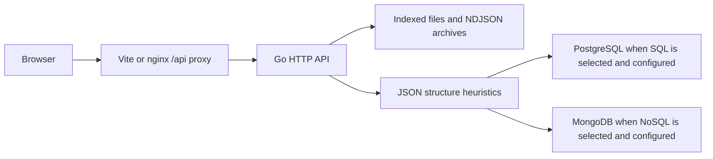

# Architecture

The storage manager maintains a filesystem layout and JSON metadata indexes. File content hashes support deduplication. JSON archives use the same index so their identifiers work with normal listing, download, notes and deletion. A bounded Badger-backed cache supports collection statistics; mutations invalidate collection keys and shutdown closes its resources.

JSON analysis examines nesting, consistency, field variation and comment hints. Its recommendation is separate from actual storage. Optional database adapters connect at startup and use bounded pools. PostgreSQL creates/inserts within a transaction; MongoDB uses unordered insertion and reports committed counts. NDJSON archival follows database writes and has a separate success count/warnings.

The system is a local single-user prototype. There is no tenant boundary, background job API, arbitrary SQL console or distributed transaction. Concurrent processes must not share the same data directory. The persistent job-queue helper package is not wired into public routes.
